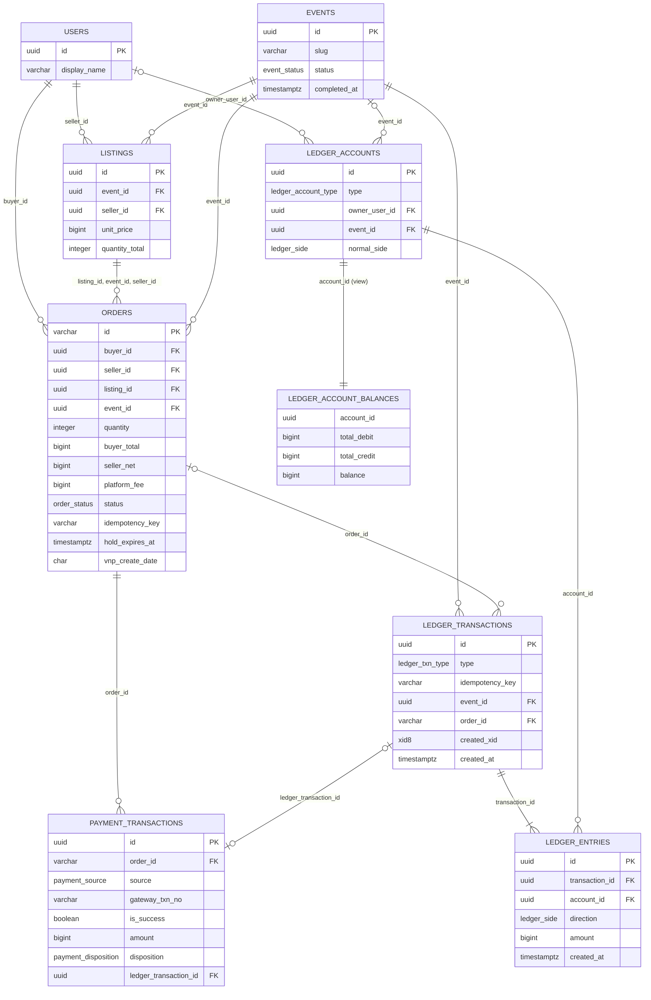

# Database Design: Ticket Checkout with Escrow

## TÓM TẮT

- **Database**: PostgreSQL 18 trong Docker Compose: service `db` chứa DB `ticket` cho app; service `db-test` riêng (compose profile `test`, dữ liệu trên tmpfs) chứa DB `ticket_test` cho test
- **Query layer**: Kysely 0.29 + driver `pg` (type DB viết tay), DDL / trigger bằng `sql` template trong migration
- **Bảng chính**: `users`, `events`, `listings`, `orders`, `payment_transactions`, `ledger_accounts`, `ledger_transactions`, `ledger_entries` + view `ledger_account_balances`

## Chi Tiết

### Schema

#### `users`

| Cột | Kiểu | Ràng buộc | Mô tả |
|-----|------|-----------|-------|
| `id` | uuid | PK, default `uuidv7()` | Seed dùng UUID cố định để cookie `current_user_id` còn khớp sau khi chạy lại seed |
| `display_name` | varchar(100) | NOT NULL | Tên hiển thị trong dropdown, sắp xếp A–Z |
| `created_at` | timestamptz | NOT NULL, default now() | |

Cờ "có tin bán" của API tính bằng `EXISTS (listings.seller_id = users.id)`, không lưu cột.

#### `events`

| Cột | Kiểu | Ràng buộc | Mô tả |
|-----|------|-----------|-------|
| `id` | uuid | PK, default `uuidv7()` | |
| `slug` | varchar(100) | NOT NULL, UNIQUE, CHECK `slug ~ '^[a-z0-9]+(-[a-z0-9]+)*$'` | Dùng ở URL `/su-kien/:slug` |
| `name` | varchar(200) | NOT NULL | |
| `description` | text | NOT NULL, default `''` | |
| `venue` | varchar(200) | NOT NULL | Địa điểm |
| `starts_at` | timestamptz | NOT NULL | Thời gian diễn ra |
| `status` | `event_status` | NOT NULL, default `'ON_SALE'` | Trigger `event_guard_transition` chặn `COMPLETED` → `ON_SALE` |
| `completed_at` | timestamptz | CHECK `(status = 'COMPLETED') = (completed_at IS NOT NULL)` | Thời điểm đánh dấu kết thúc |
| `created_at` | timestamptz | NOT NULL, default now() | |
| `updated_at` | timestamptz | NOT NULL, default now() | |

#### `listings`

| Cột | Kiểu | Ràng buộc | Mô tả |
|-----|------|-----------|-------|
| `id` | uuid | PK, default `uuidv7()` | |
| `event_id` | uuid | NOT NULL, FK → `events.id` | |
| `seller_id` | uuid | NOT NULL, FK → `users.id` | |
| `unit_price` | bigint | NOT NULL, CHECK `> 0` | Giá mỗi vé, VND |
| `quantity_total` | integer | NOT NULL, CHECK `> 0` | Tổng số vé của tin |
| `created_at` | timestamptz | NOT NULL, default now() | |
| `updated_at` | timestamptz | NOT NULL, default now() | |

- UNIQUE `(id, event_id, seller_id)`: đích của FK ghép từ `orders`, để snapshot sự kiện / người bán trên đơn luôn khớp tin bán.
- Không có cột "đã bán" / "đang giữ": số còn lại luôn tính từ `orders` (§ Các Quyết Định Kỹ Thuật).

#### `orders`

| Cột | Kiểu | Ràng buộc | Mô tả |
|-----|------|-----------|-------|
| `id` | varchar(20) | PK, CHECK `id ~ '^[A-Z0-9]{16}$'` | Mã đơn = `vnp_TxnRef` = path `/don-hang/:orderId`; `yyMMdd` (GMT+7) + 10 ký tự sinh bằng `crypto.randomInt` |
| `buyer_id` | uuid | NOT NULL, FK → `users.id`, CHECK `buyer_id <> seller_id` | Snapshot `X-User-Id` lúc tạo đơn |
| `seller_id` | uuid | NOT NULL | Snapshot từ tin bán |
| `listing_id` | uuid | NOT NULL; FK ghép `(listing_id, event_id, seller_id)` → `listings (id, event_id, seller_id)` | |
| `event_id` | uuid | NOT NULL, FK → `events.id` | Snapshot, dùng để khoá sự kiện trước khi khoá đơn |
| `quantity` | integer | NOT NULL, CHECK `> 0` | |
| `unit_price` | bigint | NOT NULL, CHECK `> 0` | Snapshot giá mỗi vé |
| `subtotal` | bigint | NOT NULL, CHECK `subtotal = unit_price * quantity` | Tiền vé |
| `buyer_fee` | bigint | NOT NULL, CHECK `buyer_fee = subtotal * 10 / 100` | Phí người mua 10%, chia nguyên của PostgreSQL = làm tròn xuống với số không âm |
| `buyer_total` | bigint | NOT NULL, CHECK `buyer_total = subtotal + buyer_fee` | Tổng phải trả = số tiền đối chiếu với `vnp_Amount / 100` |
| `seller_fee` | bigint | NOT NULL, CHECK `seller_fee = subtotal * 5 / 100` | Khấu trừ người bán 5% |
| `seller_net` | bigint | NOT NULL, CHECK `seller_net = subtotal - seller_fee` | Vào `ESCROW_SELLER` |
| `platform_fee` | bigint | NOT NULL, CHECK `platform_fee = buyer_total - seller_net` | Vào `ESCROW_FEE`; nhận phần lẻ làm tròn |
| `status` | `order_status` | NOT NULL, default `'PENDING_PAYMENT'` | Chuyển trạng thái do trigger `order_guard_transition` kiểm |
| `idempotency_key` | varchar(64) | NOT NULL; UNIQUE `(buyer_id, idempotency_key)` vĩnh viễn | Header `Idempotency-Key` |
| `hold_expires_at` | timestamptz | NOT NULL, CHECK `hold_expires_at = created_at + interval '15 minutes'` | Hạn giữ chỗ, không gia hạn; cũng là `vnp_ExpireDate` |
| `payment_url` | text | | URL VNPay đã ký, lưu ở lần tạo đầu |
| `vnp_create_date` | char(14) | CHECK `vnp_create_date ~ '^[0-9]{14}$'` | Đúng chuỗi `yyyyMMddHHmmss` GMT+7 đã gửi VNPay; `querydr` gửi lại nguyên chuỗi này làm `vnp_TransactionDate` |
| `payment_url_created_at` | timestamptz | CHECK 3 cột `payment_url`, `vnp_create_date`, `payment_url_created_at` cùng NULL hoặc cùng có giá trị | Điều kiện để `querydr` |
| `paid_at` | timestamptz | CHECK `status <> 'PAID' OR paid_at IS NOT NULL` | Thời điểm ghi nhận `PAID` |
| `failed_at` | timestamptz | CHECK `status <> 'FAILED' OR failed_at IS NOT NULL` | |
| `expired_at` | timestamptz | CHECK `status <> 'EXPIRED' OR expired_at IS NOT NULL` | Thời điểm hết hạn thực tế (job, đọc tại chỗ, hoặc kết thúc sự kiện); giữ lại khi đơn sau đó nhận tiền muộn |
| `refund_required_at` | timestamptz | CHECK `status <> 'REFUND_REQUIRED' OR refund_required_at IS NOT NULL` | |
| `created_at` | timestamptz | NOT NULL, default now() | |
| `updated_at` | timestamptz | NOT NULL, default now() | |

Số tiền cần hoàn của đơn = Σ `payment_transactions.amount` của đơn có `disposition = 'REFUND_REQUIRED'`, không lưu cột để không lệch với sổ cái.

#### `payment_transactions`

Mỗi kết quả thanh toán đã xác thực và được áp vào đơn (trả `RECORDED`). Kết quả `DUPLICATE` không ghi dòng. Append-only như sổ cái.

| Cột | Kiểu | Ràng buộc | Mô tả |
|-----|------|-----------|-------|
| `id` | uuid | PK, default `uuidv7()` | |
| `order_id` | varchar(20) | NOT NULL, FK → `orders.id` | |
| `source` | `payment_source` | NOT NULL | Kênh mang kết quả tới |
| `gateway_txn_no` | varchar(20) | NOT NULL; UNIQUE partial `WHERE is_success` | `vnp_TransactionNo`; giao dịch thất bại không chịu UNIQUE vì VNPay có thể trả cùng mã (vd `0`) |
| `response_code` | char(2) | NOT NULL | `vnp_ResponseCode` |
| `transaction_status` | char(2) | NOT NULL | `vnp_TransactionStatus` |
| `is_success` | boolean | NOT NULL, CHECK `is_success = (response_code = '00' AND transaction_status = '00')` | |
| `amount` | bigint | NOT NULL, CHECK `> 0` | VND = `vnp_Amount / 100`, đã đối chiếu bằng `orders.buyer_total` |
| `bank_code` | varchar(20) | | `vnp_BankCode` |
| `pay_date` | timestamptz | | `vnp_PayDate` (GMT+7) quy về UTC |
| `disposition` | `payment_disposition` | NOT NULL, CHECK `is_success = (disposition <> 'FAILED')` | Kết quả áp vào đơn |
| `ledger_transaction_id` | uuid | UNIQUE, FK → `ledger_transactions.id`, CHECK `(ledger_transaction_id IS NOT NULL) = is_success` | Tiền đã xác nhận luôn có đúng 1 giao dịch sổ cái |
| `created_at` | timestamptz | NOT NULL, default now() | |

#### `ledger_accounts`

| Cột | Kiểu | Ràng buộc | Mô tả |
|-----|------|-----------|-------|
| `id` | uuid | PK, default `uuidv7()` | Mã tài khoản sổ cái, dùng ở URL `/quan-tri/so-cai/:accountId` |
| `type` | `ledger_account_type` | NOT NULL | |
| `owner_user_id` | uuid | FK → `users.id` | Người bán / người mua sở hữu tài khoản |
| `event_id` | uuid | FK → `events.id` | Sự kiện của tài khoản ký quỹ |
| `normal_side` | `ledger_side` | NOT NULL, CHECK `normal_side = CASE WHEN type = 'GATEWAY_CASH' THEN 'DEBIT' ELSE 'CREDIT' END` | Bên tăng số dư: tài sản = `DEBIT`, nợ phải trả / doanh thu = `CREDIT` |
| `created_at` | timestamptz | NOT NULL, default now() | |

- CHECK hình dạng chủ sở hữu theo loại:
  - `GATEWAY_CASH`, `PLATFORM_FEE_REVENUE`: `owner_user_id` NULL, `event_id` NULL (1 tài khoản của sàn).
  - `ESCROW_SELLER`: `owner_user_id` NOT NULL, `event_id` NOT NULL (1 tài khoản / cặp người bán, sự kiện).
  - `ESCROW_FEE`: `owner_user_id` NULL, `event_id` NOT NULL (1 tài khoản / sự kiện).
  - `SELLER_PAYABLE`, `BUYER_REFUND_PAYABLE`: `owner_user_id` NOT NULL, `event_id` NULL (1 tài khoản / người dùng).
- UNIQUE NULLS NOT DISTINCT `(type, owner_user_id, event_id)` (constraint `ledger_accounts_key_uq`): NULL được coi là bằng nhau, nên tài khoản sàn cũng chỉ có 1 dòng.

#### `ledger_transactions`

| Cột | Kiểu | Ràng buộc | Mô tả |
|-----|------|-----------|-------|
| `id` | uuid | PK, default `uuidv7()` | Mã giao dịch sổ cái |
| `type` | `ledger_txn_type` | NOT NULL | |
| `idempotency_key` | varchar(100) | NOT NULL, UNIQUE; CHECK `(type = 'EVENT_RELEASE') = (idempotency_key LIKE 'EVENT_RELEASE:%')` | `PAYMENT:<vnp_TransactionNo>` cho cả `PAYMENT_CAPTURED` và `PAYMENT_REFUND_REQUIRED` (1 giao dịch cổng → tối đa 1 giao dịch sổ cái); `EVENT_RELEASE:<event_id>` |
| `event_id` | uuid | NOT NULL, FK → `events.id` | Mọi giao dịch đều thuộc 1 sự kiện; dùng cho bộ lọc `eventId` của sổ cái |
| `order_id` | varchar(20) | FK → `orders.id`, CHECK `(type = 'EVENT_RELEASE') = (order_id IS NULL)` | Tham chiếu đơn của giao dịch thanh toán |
| `description` | varchar(255) | NOT NULL | Mô tả tiếng Việt: "Bán 2 vé · Tên sự kiện · Đơn mã đơn", "Khoản hoàn tiền · Đơn mã đơn", "Giải phóng ký quỹ · Tên sự kiện" (tên sự kiện cắt cho vừa 255) |
| `created_xid` | xid8 | NOT NULL; trigger `ledger_txn_stamp` ép = `pg_current_xact_id()` | ID transaction PostgreSQL đã tạo giao dịch; chỉ transaction đó được thêm dòng bút toán |
| `created_at` | timestamptz | NOT NULL, default now() | |

#### `ledger_entries`

| Cột | Kiểu | Ràng buộc | Mô tả |
|-----|------|-----------|-------|
| `id` | uuid | PK, default `uuidv7()` | |
| `transaction_id` | uuid | NOT NULL, FK → `ledger_transactions.id` | |
| `account_id` | uuid | NOT NULL, FK → `ledger_accounts.id` | |
| `direction` | `ledger_side` | NOT NULL | Ghi nợ / ghi có |
| `amount` | bigint | NOT NULL, CHECK `amount > 0` | VND; dòng 0 đồng không được ghi (vd `platform_fee` = 0 khi tiền vé < 10 ₫) |
| `created_at` | timestamptz | NOT NULL; trigger `ledger_entry_guard` ép = `created_at` của giao dịch | Chép xuống để index `(account_id, created_at)` phục vụ lịch sử theo tài khoản |

Trigger trên bảng này: `ledger_entry_guard` (BEFORE INSERT), `ledger_entries_balanced` (constraint trigger deferred), `ledger_reject_mutation` (BEFORE UPDATE OR DELETE) — § Các Quyết Định Kỹ Thuật.

#### `ledger_account_balances` (VIEW)

Nguồn duy nhất của công thức số dư; mọi endpoint số dư / sổ cái / ký quỹ đọc từ view này, không tự cộng ở code.

| Cột | Kiểu | Ràng buộc | Mô tả |
|-----|------|-----------|-------|
| `account_id` | uuid | = `ledger_accounts.id` | `ledger_accounts LEFT JOIN ledger_entries` nhóm theo tài khoản, tài khoản chưa có dòng vẫn ra 0 |
| `type`, `owner_user_id`, `event_id`, `normal_side` | | | Chép từ `ledger_accounts` |
| `total_debit` | bigint | | `COALESCE(SUM(amount) FILTER (WHERE direction = 'DEBIT'), 0)::bigint` |
| `total_credit` | bigint | | `COALESCE(SUM(amount) FILTER (WHERE direction = 'CREDIT'), 0)::bigint` |
| `balance` | bigint | | `normal_side = 'DEBIT'` → `total_debit - total_credit`; `normal_side = 'CREDIT'` → `total_credit - total_debit` |

`SUM(bigint)` của PostgreSQL trả `numeric` (driver `pg` đọc ra string) nên view ép `::bigint`.

### Enums

#### `event_status`

| Giá trị | Ý nghĩa | Ghi chú |
|---------|---------|---------|
| `ON_SALE` | Đang bán | default |
| `COMPLETED` | Đã kết thúc, ngừng bán | Một chiều, không quay lại `ON_SALE` |

- **Dùng ở**: `events.status`
- **Lưu trữ**: native enum (`CREATE TYPE`) — lý do: tập giá trị đóng, DB tự từ chối giá trị lạ

#### `order_status`

| Giá trị | Ý nghĩa | Ghi chú |
|---------|---------|---------|
| `PENDING_PAYMENT` | Chờ thanh toán, đang giữ chỗ tới `hold_expires_at` | default; → `PAID`, `FAILED`, `EXPIRED`, `REFUND_REQUIRED` |
| `PAID` | Đã thanh toán, vé đã bán | Trạng thái cuối |
| `FAILED` | Cổng báo thất bại / người mua huỷ, vé trả lại tin bán | → `PAID`, `REFUND_REQUIRED` (tiền thành công đến muộn) |
| `EXPIRED` | Quá hạn giữ chỗ hoặc sự kiện kết thúc, vé trả lại tin bán | → `PAID`, `REFUND_REQUIRED` (tiền thành công đến muộn) |
| `REFUND_REQUIRED` | Đã nhận tiền nhưng không giữ được vé, khoản phải hoàn nằm ở `BUYER_REFUND_PAYABLE` | Trạng thái cuối |

- **Dùng ở**: `orders.status`
- **Lưu trữ**: native enum (`CREATE TYPE`) — lý do: tập giá trị đóng; bảng chuyển trạng thái ở cột Ghi chú do trigger `order_guard_transition` thực thi

#### `payment_source`

| Giá trị | Ý nghĩa | Ghi chú |
|---------|---------|---------|
| `IPN` | VNPay gọi server-to-server (hoặc script gửi IPN giả khi dev) | |
| `RETURN_URL` | Tham số có chữ ký trên đường quay về, web chuyển tiếp cho `api` | |
| `QUERYDR` | `api` tự tra cứu VNPay | |

- **Dùng ở**: `payment_transactions.source`
- **Lưu trữ**: native enum (`CREATE TYPE`) — lý do: tập giá trị đóng, chỉ dùng truy vết

#### `payment_disposition`

| Giá trị | Ý nghĩa | Ghi chú |
|---------|---------|---------|
| `CAPTURED` | Tiền thành công, đơn thành `PAID`, ghi `PAYMENT_CAPTURED` | |
| `REFUND_REQUIRED` | Tiền thành công nhưng phải hoàn (đến muộn không còn vé / sự kiện đã kết thúc / thanh toán thừa), ghi `PAYMENT_REFUND_REQUIRED` | |
| `FAILED` | Kết quả thất bại áp vào đơn `PENDING_PAYMENT`, không ghi sổ cái | |

- **Dùng ở**: `payment_transactions.disposition`
- **Lưu trữ**: native enum (`CREATE TYPE`) — lý do: tập giá trị đóng

#### `ledger_account_type`

| Giá trị | Ý nghĩa | Ghi chú |
|---------|---------|---------|
| `GATEWAY_CASH` | Tiền nhận qua cổng (tài sản) | `normal_side` = `DEBIT` |
| `ESCROW_SELLER` | Ký quỹ tiền bán vé của 1 người bán trong 1 sự kiện = số dư đang chờ | `CREDIT` |
| `ESCROW_FEE` | Ký quỹ phí sàn của 1 sự kiện | `CREDIT` |
| `SELLER_PAYABLE` | Phải trả người bán = số dư khả dụng từ bán vé | `CREDIT` |
| `BUYER_REFUND_PAYABLE` | Phải hoàn người mua = số dư khả dụng từ khoản cần hoàn | `CREDIT` |
| `PLATFORM_FEE_REVENUE` | Doanh thu phí sàn | `CREDIT` |

- **Dùng ở**: `ledger_accounts.type`
- **Lưu trữ**: native enum (`CREATE TYPE`) — lý do: thứ tự khai báo trùng thứ tự hiển thị của spec api § E, nên `ORDER BY type` ra đúng thứ tự mà không cần bảng map

#### `ledger_side`

| Giá trị | Ý nghĩa | Ghi chú |
|---------|---------|---------|
| `DEBIT` | Ghi nợ | |
| `CREDIT` | Ghi có | |

- **Dùng ở**: `ledger_entries.direction`, `ledger_accounts.normal_side`
- **Lưu trữ**: native enum (`CREATE TYPE`) — lý do: tập giá trị đóng, dùng chung cho 2 cột để so `direction = normal_side`

#### `ledger_txn_type`

| Giá trị | Ý nghĩa | Ghi chú |
|---------|---------|---------|
| `PAYMENT_CAPTURED` | Nợ `GATEWAY_CASH` `buyer_total`; Có `ESCROW_SELLER` `seller_net`; Có `ESCROW_FEE` `platform_fee` | |
| `PAYMENT_REFUND_REQUIRED` | Nợ `GATEWAY_CASH` số tiền nhận; Có `BUYER_REFUND_PAYABLE` của người mua cùng số tiền | |
| `EVENT_RELEASE` | Mỗi `ESCROW_SELLER` của sự kiện có số dư > 0: Nợ toàn bộ số dư, Có `SELLER_PAYABLE` của người bán; `ESCROW_FEE` > 0: Nợ toàn bộ số dư, Có `PLATFORM_FEE_REVENUE` | 1 giao dịch nhiều dòng / sự kiện |

- **Dùng ở**: `ledger_transactions.type`
- **Lưu trữ**: native enum (`CREATE TYPE`) — lý do: tập giá trị đóng; thêm loại điều chỉnh sau này bằng `ALTER TYPE ... ADD VALUE`

### Sơ Đồ ERD



### Quan Hệ

```text
users 1──* listings (seller_id)
events 1──* listings (event_id)
users 1──* orders (buyer_id)
listings 1──* orders (listing_id, event_id, seller_id — FK ghép, snapshot luôn khớp tin bán)
events 1──* orders (event_id)
orders 1──* payment_transactions (order_id)
ledger_transactions 1──0..1 payment_transactions (ledger_transaction_id, chỉ giao dịch thành công)
users 1──* ledger_accounts (owner_user_id, nullable với tài khoản sàn / ESCROW_FEE)
events 1──* ledger_accounts (event_id, nullable với tài khoản không theo sự kiện)
events 1──* ledger_transactions (event_id)
orders 1──* ledger_transactions (order_id, NULL với EVENT_RELEASE)
ledger_transactions 1──2..* ledger_entries (transaction_id)
ledger_accounts 1──* ledger_entries (account_id)
ledger_accounts 1──1 ledger_account_balances (view)
```

Mọi FK là `ON DELETE NO ACTION`: không xoá được người dùng / sự kiện / đơn đã có bút toán.

### Indexing

| Bảng | Cột | Loại | Lý do |
|------|-----|------|-------|
| `events` | `slug` | B-tree unique (từ UNIQUE) | Trang sự kiện tra theo slug |
| `listings` | `event_id` | B-tree | Danh sách tin bán của sự kiện |
| `orders` | `(buyer_id, idempotency_key)` | B-tree unique | Chống tạo đơn trùng, kể cả 2 request đồng thời |
| `orders` | `(listing_id, status)` INCLUDE `(quantity, hold_expires_at)` | B-tree composite covering | Tính số vé còn lại của tin bán (Σ vé `PAID` + `PENDING_PAYMENT` còn hạn) khi đang giữ khoá tin bán |
| `orders` | `hold_expires_at` WHERE `status = 'PENDING_PAYMENT'` | B-tree partial | Job hết hạn và hết hạn tại chỗ chỉ quét đơn đang chờ |
| `orders` | `(event_id, hold_expires_at)` WHERE `status = 'PENDING_PAYMENT'` | B-tree partial | `pendingOrderCount` của sự kiện; kết thúc sự kiện chuyển đơn chờ của sự kiện sang `EXPIRED` |
| `orders` | `(buyer_id, created_at DESC)` | B-tree composite | Trang Đơn hàng: đơn của người mua, mới nhất trước |
| `orders` | `created_at DESC` | B-tree | Danh sách mọi đơn (không lọc `buyerId`) |
| `payment_transactions` | `gateway_txn_no` WHERE `is_success` | B-tree unique partial | Chống ghi nhận trùng giao dịch thành công ở tầng DB |
| `payment_transactions` | `order_id` | B-tree | Số tiền cần hoàn của đơn, truy vết thanh toán |
| `ledger_accounts` | `(type, owner_user_id, event_id)` NULLS NOT DISTINCT | B-tree unique | Upsert tài khoản bằng `INSERT ... ON CONFLICT ON CONSTRAINT ledger_accounts_key_uq DO NOTHING` |
| `ledger_accounts` | `owner_user_id` | B-tree | Số dư đang chờ / khả dụng của người dùng |
| `ledger_accounts` | `event_id` | B-tree | `escrowTotal`, `sellerCount`, giải phóng ký quỹ của sự kiện |
| `ledger_transactions` | `idempotency_key` | B-tree unique (từ UNIQUE) | Chống ghi trùng bút toán |
| `ledger_transactions` | `(created_at DESC, id DESC)` | B-tree composite | Danh sách giao dịch toàn sổ, mới nhất trước |
| `ledger_transactions` | `(event_id, created_at DESC)` | B-tree composite | Bộ lọc `eventId` của sổ cái |
| `ledger_entries` | `transaction_id` | B-tree | Trigger kiểm cân bằng và hiển thị dòng của giao dịch |
| `ledger_entries` | `(account_id, created_at DESC, transaction_id DESC)` | B-tree composite | View số dư, lịch sử bút toán theo tài khoản / người dùng, mới nhất trước, cùng thời điểm theo mã giao dịch |

### Conventions

- **Timezone**: cột mốc thời điểm dùng `timestamptz` lưu UTC, FE convert sang giờ địa phương
  - Ngày thuần dùng `date`, giờ thuần dùng `time` (rule `policy-api` § Query, naming, date)
  - Ngoại lệ duy nhất: `orders.vnp_create_date` char(14) giữ nguyên chuỗi GMT+7 đã ký gửi VNPay, vì `timestamptz` có micro giây nên tính lại có thể ra chuỗi khác
- **Tiền**: `bigint` VND, không `numeric` / số thực; driver `pg` parse `int8` thành `number` qua 1 parser kiểm `Number.isSafeInteger` (lệch → throw), vì `vnp_Amount` tối đa 12 chữ số nên mọi số tiền < 2^53
- **Soft delete**: không dùng — hard delete; thực tế app không xoá bảng nào, `ledger_*` và `payment_transactions` bị trigger chặn DELETE
- **Audit fields**: `created_at` ở mọi bảng; `updated_at` chỉ ở bảng có cập nhật (`events`, `listings`, `orders`), app set `updated_at = now()` trong câu UPDATE; không `created_by` vì không có đăng nhập (người thao tác đã nằm trong snapshot `orders.buyer_id`)
- **Primary key**: UUID v7 (`uuidv7()`, PostgreSQL 18) — lý do: sắp xếp gần theo thời gian tạo, không lộ số lượng bản ghi, khớp regex mã `^[A-Za-z0-9_-]+$` của spec api; ngoại lệ: `orders.id` = mã đơn 16 ký tự chữ hoa + số, vì là `vnp_TxnRef` và nằm trên URL (UUID có `-` và dài 36 ký tự, vượt 12–20 ký tự chữ số của spec)
- **Naming**: bảng `snake_case` số nhiều (`orders`), cột `snake_case`, FK `<table_singular>_id` (`event_id`); ngoại lệ có nghĩa nghiệp vụ: `buyer_id`, `seller_id`, `owner_user_id` → `users.id`
- **DB roles**: không dùng cặp `app_owner` / `app_runtime` (quyết định của user cho bài test local) — 1 role `ticket` (`POSTGRES_USER`) vừa chạy migrate vừa là role runtime; tính bất biến của sổ cái dựa vào trigger chặn UPDATE / DELETE, không dựa vào REVOKE
- **Migration tool**: Kysely `Migrator` + `FileMigrationProvider`, chạy bằng `node dist/db/migrate.js` trước khi server start; Kysely giữ lock bảng migration nên 2 container chạy cùng lúc không áp trùng
- **Migration**:
  - Naming: `apps/api/src/db/migrations/YYYYMMDDHHmm_verb_subject.ts` (vd `202610271200_create_ledger.ts`), mỗi file export `up`; DDL, trigger, view viết bằng `sql` template
  - Zero-downtime: thêm cột nullable → backfill → thêm NOT NULL ở migration sau
  - Drop cột/bảng ở release sau release đã bỏ code dùng nó
  - Forward-only (rule `destructive-ops`): sai schema → viết migration mới để sửa; không viết `down`; DB `ticket_test` nằm trên tmpfs nên mỗi lần dựng `db-test` là DB trống, `migrate` áp lại từ đầu
  - Mỗi migration chạy trong 1 transaction (DDL của PostgreSQL có transaction), lỗi giữa chừng không để schema nửa vời
- **Transaction boundary**: mở ở service layer; repository nhận `trx` (`Kysely<DB>` hoặc `Transaction<DB>`) làm tham số, không tự mở transaction — helper: `db.transaction().setIsolationLevel('read committed').execute(async (trx) => { ... })`
  - Isolation READ COMMITTED + khoá hàng tường minh (`.forShare()`, `.forUpdate()`); sau khi chờ khoá, mỗi câu lệnh đọc snapshot mới nên thấy dữ liệu bên trước vừa commit
  - Thứ tự khoá cố định ở mọi luồng: `events` → `listings` → `orders`; luồng không cần 1 cấp thì bỏ cấp đó, không bao giờ khoá cấp trên sau khi đã giữ cấp dưới (chống deadlock)
  - Lời gọi VNPay (`querydr`) luôn nằm ngoài transaction, có kết quả mới mở transaction ghi nhận; không giữ khoá DB trong lúc chờ mạng
  - Trình tự khoá từng luồng ở § Các Quyết Định Kỹ Thuật → "Chống bán trùng"
- **Seed data**:
  - Vị trí: `apps/api/src/db/seed.ts` (chạy `node dist/db/seed.js`), entrypoint container `api` chạy `migrate` → `seed` → server
  - Phạm vi: dev + test; không có môi trường production. Dữ liệu: 4 người dùng (2 người bán, 1 người vừa bán vừa mua, 1 người mua), 2 sự kiện `ON_SALE`, ≥ 5 tin bán của ≥ 2 người bán, có 1 tin giá 333.333 ₫ để thấy làm tròn phí; không seed đơn hay bút toán — sổ cái chỉ sinh từ luồng thật
  - Dữ liệu nền trong migration: 2 tài khoản sàn `GATEWAY_CASH`, `PLATFORM_FEE_REVENUE`; code vẫn upsert mọi loại tài khoản nên thiếu cũng tự tạo lại
  - Idempotent: UUID cố định + `INSERT ... ON CONFLICT (id) DO NOTHING`, chạy lại mỗi lần container start không lỗi, không ghi đè dữ liệu đã đổi (sự kiện đã `COMPLETED` giữ nguyên)
  - Admin đầu tiên: không có — không đăng nhập, Khu Quản Trị mở cho mọi người dùng
  - Test: DB `ticket_test` ở service riêng `db-test` (`postgres:18-alpine`, compose profile `test`, dữ liệu trên tmpfs, không volume); service `db` dev chỉ chứa DB `ticket` — lý do: rule `destructive-ops` § Database (không bao giờ dùng DB dev làm DB test, `TRUNCATE` chỉ trên DB test ephemeral)
    - Guard tên DB đuôi `_test` 2 lớp trước mọi migrate / `TRUNCATE`: (1) đọc `DATABASE_URL`, in host + tên DB, tên sai → throw trước khi kết nối; (2) `SELECT current_database()` trên kết nối thật, sai → throw
    - Mỗi test `TRUNCATE ... CASCADE` mọi bảng rồi nạp fixture riêng (TRUNCATE không kích hoạt trigger chặn UPDATE / DELETE)

### Các Quyết Định Kỹ Thuật

- **Sổ cái kép 3 bảng, số dư chỉ là phép cộng**: `ledger_accounts` (tài khoản + `normal_side`), `ledger_transactions` (giao dịch + khoá chống trùng), `ledger_entries` (dòng nợ / có, `amount > 0`); không có cột số dư ở đâu, view `ledger_account_balances` là công thức duy nhất — trade-off: mỗi lần đọc phải SUM toàn bộ dòng của tài khoản — alternatives considered: cột `balance` cập nhật cùng giao dịch (nhanh nhưng có thể lệch sổ và là hot row khoá `GATEWAY_CASH` mọi thanh toán), snapshot số dư định kỳ (thừa với dữ liệu mẫu) — khi nào xem lại: một tài khoản vượt ~10^5 dòng thì thêm bảng snapshot số dư theo mốc + cộng phần sau mốc
- **Công thức số dư từ sổ cái** (view `ledger_account_balances`, `bal(a)` = `balance` của tài khoản `a`):
  - Tài sản (`GATEWAY_CASH`): Σ nợ − Σ có; nợ phải trả / doanh thu (5 loại còn lại): Σ có − Σ nợ
  - Số dư đang chờ của người dùng `u` = Σ `bal` các `ESCROW_SELLER` có `owner_user_id = u` (mọi sự kiện)
  - Số dư khả dụng của `u` = `bal(SELLER_PAYABLE u)` (từ bán vé) + `bal(BUYER_REFUND_PAYABLE u)` (từ khoản cần hoàn)
  - Lịch sử của `u` = mọi `ledger_entries` của tài khoản có `owner_user_id = u`; số tiền có dấu = `+amount` khi `direction = normal_side`, ngược lại `−amount`; loại số dư = `PENDING` với `ESCROW_SELLER`, `AVAILABLE` với 2 loại còn lại → cộng mọi dòng cùng loại ra đúng số dư đó
  - `escrowTotal` của sự kiện `e` = Σ `bal(ESCROW_SELLER *, e)` + `bal(ESCROW_FEE e)` = đúng số tiền `EVENT_RELEASE` sẽ chuyển; `sellerCount` = số `ESCROW_SELLER` của `e` có `bal > 0`
  - Bất biến toàn sổ: Σ nợ = Σ có trên mọi dòng (hệ quả của từng giao dịch cân), nên `bal(GATEWAY_CASH)` = Σ `bal` mọi tài khoản `CREDIT`; trang sổ cái hiển thị cả 2 vế và test kiểm sau mỗi kịch bản
- **Cân bằng kiểm ở DB bằng constraint trigger deferred**: hàm `ledger_assert_balanced(txn_id)` kiểm giao dịch có ≥ 2 dòng và Σ nợ = Σ có, sai → `RAISE EXCEPTION 'LEDGER_UNBALANCED'` (`ERRCODE = 'check_violation'`, SQLSTATE `23514`)
  - Gắn 2 `CONSTRAINT TRIGGER ... AFTER INSERT ... DEFERRABLE INITIALLY DEFERRED FOR EACH ROW`: `ledger_entries_balanced` trên `ledger_entries` (kiểm `NEW.transaction_id`) và `ledger_transactions_balanced` trên `ledger_transactions` (kiểm `NEW.id`, bắt giao dịch không có dòng nào)
  - Deferred nên chạy lúc COMMIT, sau khi mọi dòng của giao dịch đã chèn; lệch thì cả transaction (đơn, trạng thái, bút toán) rollback
  - Code `api` kiểm trước khi chèn để log `LEDGER_UNBALANCED` có ngữ cảnh (spec api § E); trigger là chốt cuối khi code sai — test chèn thẳng 1 giao dịch lệch bằng SQL và chờ COMMIT lỗi
  - Trade-off: N dòng → N lần kiểm lúc commit (mỗi lần SUM vài dòng) — alternatives considered: chỉ kiểm ở code (bug code là sổ lệch), CHECK constraint (không nhìn được nhiều dòng)
- **Không thêm dòng vào giao dịch đã commit**: trigger `ledger_txn_stamp` (BEFORE INSERT `ledger_transactions`) ép `created_xid = pg_current_xact_id()`, `created_at = now()`; trigger `ledger_entry_guard` (BEFORE INSERT `ledger_entries`) ép `created_at` = của giao dịch cha và từ chối bằng `RAISE EXCEPTION 'LEDGER_TRANSACTION_CLOSED'` (`ERRCODE = 'check_violation'`) khi `created_xid` của giao dịch cha ≠ `pg_current_xact_id()`
  - Fail-closed: không thấy giao dịch cha cũng từ chối, vì transaction luôn thấy dòng chính nó chèn nên "không thấy cha" = cha thuộc transaction khác chưa commit (khe race trước khi FK kiểm) hoặc không tồn tại; migration `202610291000_ledger_entry_guard_fail_closed` thay hàm `ledger_entry_guard` bằng `CREATE OR REPLACE FUNCTION`
  - Lý do: thiếu chốt này, một cặp dòng cân thêm sau vẫn qua kiểm cân bằng nhưng đã sửa lịch sử — alternatives considered: so `created_at = now()` (dựa vào trùng micro giây)
- **Bất biến**: trigger `ledger_reject_mutation` BEFORE UPDATE OR DELETE FOR EACH ROW trên `ledger_transactions`, `ledger_entries`, `payment_transactions` → `RAISE EXCEPTION 'LEDGER_IMMUTABLE'` (`ERRCODE = 'restrict_violation'`, SQLSTATE `23001`); sai sót sửa bằng giao dịch bù (phạm vi hiện tại chưa có loại điều chỉnh) — trade-off: TRUNCATE và DDL của owner không bị chặn (cần cho reset test) — alternatives considered: REVOKE UPDATE / DELETE với role runtime riêng (đã bỏ theo quyết định user) — khi nào xem lại: lên production → tách role `app_owner` / `app_runtime`, REVOKE UPDATE, DELETE, TRUNCATE trên các bảng này
- **Tài khoản sổ cái tạo khi phát sinh tiền**: `INSERT ... ON CONFLICT ON CONSTRAINT ledger_accounts_key_uq DO NOTHING` rồi `SELECT id` trong cùng transaction; 2 giao dịch cùng tạo 1 tài khoản → bên sau chờ bên trước commit rồi `DO NOTHING`, câu `SELECT` kế tiếp thấy dòng đã có; CHECK hình dạng chủ sở hữu + `normal_side` theo loại làm DB từ chối tài khoản sai loại — alternatives considered: tạo sẵn mọi tài khoản trong seed (thiếu khi có người bán / sự kiện mới), `UNIQUE` thường (NULL khác nhau → 2 tài khoản `GATEWAY_CASH`)
- **Snapshot tiền trên đơn có CHECK công thức**: 6 cột tiền của `orders` bị CHECK ràng buộc lẫn nhau (`seller_net + platform_fee = buyer_total` suy ra từ các CHECK), nên `PAYMENT_CAPTURED` dùng snapshot luôn cân; module phí thuần ở `api` tính trước, DB từ chối nếu code tính sai — ví dụ kiểm: 500.000 × 2 → 1.100.000 / 950.000 / 150.000; 333.333 × 1 → 366.666 / 316.667 / 49.999
- **State machine của đơn ở DB**: trigger `order_guard_transition` (BEFORE UPDATE `orders`):
  - Chỉ cho các cạnh `PENDING_PAYMENT` → `PAID` / `FAILED` / `EXPIRED` / `REFUND_REQUIRED`; `EXPIRED` → `PAID` / `REFUND_REQUIRED`; `FAILED` → `PAID` / `REFUND_REQUIRED`; `PAID`, `REFUND_REQUIRED` là trạng thái cuối; cạnh khác → `RAISE EXCEPTION 'ORDER_INVALID_TRANSITION'` (`ERRCODE = 'check_violation'`)
  - Từ chối mọi thay đổi ở cột snapshot (`buyer_id`, `seller_id`, `listing_id`, `event_id`, `quantity`, 7 cột tiền, `idempotency_key`, `hold_expires_at`) và ở `payment_url` / `vnp_create_date` khi đã có giá trị → `RAISE EXCEPTION 'ORDER_SNAPSHOT_IMMUTABLE'` (`ERRCODE = 'check_violation'`)
  - Sự kiện: trigger `event_guard_transition` (BEFORE UPDATE `events`) chặn `COMPLETED` → trạng thái khác bằng `RAISE EXCEPTION 'EVENT_INVALID_TRANSITION'` (`ERRCODE = 'check_violation'`)
  - Cạnh nào được đi trong hoàn cảnh nào (còn hạn, còn vé, sự kiện còn bán) do service quyết định dưới khoá — xem `specs/architecture.md` § Các Quyết Định Kỹ Thuật → "Ghi nhận thanh toán"
  - Trade-off: thêm 1 hàm PL/pgSQL phải giữ đồng bộ với enum — alternatives considered: chỉ kiểm ở code (UPDATE sai từ chỗ khác lọt qua)
- **Chống bán trùng: tồn kho tính từ đơn, tuần tự hoá bằng khoá tin bán**: số vé còn lại = `quantity_total` − Σ `quantity` của đơn cùng tin có `status = 'PAID'` hoặc (`status = 'PENDING_PAYMENT'` và `hold_expires_at > now()`); mọi thao tác làm giảm số còn lại (tạo đơn, ghi nhận thanh toán thành công chuyển `PAID`) chạy sau `SELECT ... FROM listings ... FOR UPDATE`, nên 2 người mua cùng tin bán xếp hàng và người sau thấy vé người trước vừa giữ. `now()` là giờ bắt đầu transaction: sau khi chờ khoá, đơn khác vừa quá hạn trong lúc chờ vẫn bị tính là đang giữ → sai về phía an toàn (từ chối thừa, không bán quá). Trình tự khoá từng luồng:
  - Tạo đơn: (0) tra `(buyer_id, idempotency_key)` không khoá → có thì trả đơn cũ (200) hoặc `IDEMPOTENCY_KEY_REUSED`; (1) `events` FOR SHARE, `COMPLETED` → `EVENT_NOT_ON_SALE`; (2) `listings` FOR UPDATE, người bán = người mua → `CANNOT_BUY_OWN_LISTING`; (3) tra lại idempotency, tính số còn lại, thiếu → `INSUFFICIENT_QUANTITY`; INSERT đơn với `hold_expires_at = now() + 15 phút`. Hai request cùng khoá khác tin bán không cùng khoá tin bán → UNIQUE `(buyer_id, idempotency_key)` báo `23505` → rollback, đọc lại đơn đã có rồi trả 200 / 409
  - Ghi nhận thanh toán (IPN / return URL / `querydr`): (0) đọc `event_id`, `listing_id`, `buyer_total` của đơn không khoá (cột snapshot bất biến), đối chiếu số tiền; (1) `events` FOR SHARE; (2) `listings` FOR UPDATE; (3) `orders` FOR UPDATE; chống trùng, áp trạng thái, ghi `payment_transactions` + sổ cái trong cùng transaction
    - Tiền thành công cho đơn chưa `PAID` / `REFUND_REQUIRED` (`PENDING_PAYMENT` còn hạn hay quá hạn, `EXPIRED`, `FAILED`) đi chung 1 phép kiểm: sự kiện không `ON_SALE` (kể cả `COMPLETED`) → `REFUND_REQUIRED` + `PAYMENT_REFUND_REQUIRED`; sự kiện `ON_SALE` → số còn lại = `quantity_total` − `sumReservedQuantity` của tin, loại chính đơn này (`excludeOrderId`), tính dưới khoá tin bán; ≥ `quantity` của đơn → `PAID` + `PAYMENT_CAPTURED`, ngược lại → `REFUND_REQUIRED` + `PAYMENT_REFUND_REQUIRED`
    - Không có lối tắt "đơn `PENDING_PAYMENT` còn hạn → `PAID`": "còn hạn" so với `now()` = giờ BEGIN của transaction ghi nhận, có thể trước lúc lấy được khoá tin bán; trong lúc chờ, hạn của đơn có thể đã qua và một đơn khác (tạo sau mốc hạn đó, nên không tính đơn này là đang giữ) đã lấy chính các vé đó → tin vào đồng hồ cũ cho riêng đơn này là bán vượt. Phép đếm các đơn khác vẫn dùng `now()` cũ, sai về phía an toàn như trên
  - Kết thúc sự kiện: (1) `events` FOR UPDATE — chờ mọi tạo đơn / ghi nhận đang giữ FOR SHARE của sự kiện commit, và chặn các luồng mới tới khi xong; (3) `UPDATE orders SET status = 'EXPIRED'` mọi đơn `PENDING_PAYMENT` của sự kiện; đọc view số dư ký quỹ của sự kiện; INSERT `EVENT_RELEASE`. Ghi nhận commit trước → tiền đã trong ký quỹ và được giải phóng; ghi nhận chạy sau → thấy `COMPLETED` + đơn `EXPIRED` → nhánh `REFUND_REQUIRED`
  - Hết hạn và tạo URL thanh toán: chỉ đụng `orders`, 1 câu lệnh autocommit, không giữ khoá cấp trên → không tạo vòng chờ
  - `events` dùng FOR SHARE ở tạo đơn / ghi nhận để các luồng này trên cùng sự kiện chạy song song, chỉ loại trừ với kết thúc sự kiện — alternatives considered: SERIALIZABLE (mọi luồng phải retry lỗi `40001`), cột `quantity_sold` / `quantity_held` (phải hoàn lại bằng tay khi hết hạn, dễ lệch khi job trễ), advisory lock theo tin bán (không hiện trong `pg_locks` theo hàng, khó đọc hơn)
- **Giữ chỗ 15 phút và hết hạn**: giữ chỗ không có bản ghi riêng — đơn `PENDING_PAYMENT` có `hold_expires_at > now()` chính là chỗ đang giữ, nên hết hạn có hiệu lực đúng giây thứ 900 dù job chưa chạy
  - Job `croner` mỗi 60 giây: `UPDATE orders SET status = 'EXPIRED', expired_at = now(), updated_at = now() WHERE id IN (SELECT id FROM orders WHERE status = 'PENDING_PAYMENT' AND hold_expires_at <= now() ORDER BY id LIMIT 500 FOR UPDATE SKIP LOCKED) RETURNING id`; `SKIP LOCKED` bỏ qua đơn đang bị luồng ghi nhận / kết thúc sự kiện giữ khoá (luồng đó tự quyết trạng thái); câu lệnh lặp lại tới khi trả < 500 dòng
  - Hết hạn tại chỗ khi đọc: cùng câu `UPDATE` có điều kiện `status = 'PENDING_PAYMENT' AND hold_expires_at <= now()` cho 1 đơn (xem đơn) hoặc theo `buyer_id` (danh sách đơn), chạy trước câu `SELECT`; điều kiện trong `WHERE` làm thao tác idempotent
  - Hết hạn / thất bại không ghi sổ cái (chưa có tiền)
  - Hạn phiên VNPay (`vnp_ExpireDate`) = `hold_expires_at` để cổng ngừng nhận tiền khi chỗ hết hạn, giảm tiền đến muộn
- **Chống ghi nhận trùng 3 lớp**: (1) dưới khoá đơn, tra `payment_transactions` theo `gateway_txn_no` thành công → `DUPLICATE`; (2) UNIQUE partial `payment_transactions (gateway_txn_no) WHERE is_success`; (3) UNIQUE `ledger_transactions.idempotency_key = 'PAYMENT:<vnp_TransactionNo>'`. Lớp 1 đủ khi các luồng xếp hàng qua khoá đơn; lớp 2–3 là chốt khi code sai: `23505` → rollback, chạy lại hàm ghi nhận 1 lần và nhận `DUPLICATE`. `EVENT_RELEASE` chống trùng bằng `EVENT_RELEASE:<event_id>` cộng với việc sự kiện đã `COMPLETED`
- **Kysely + SQL tường minh thay ORM**: khoá hàng, `SKIP LOCKED`, `ON CONFLICT ON CONSTRAINT`, trigger và view là phần quan trọng nhất của bài; Kysely biểu diễn trực tiếp, phần còn lại viết `sql` template trong migration — trade-off: type DB viết tay (~8 bảng + 1 view) phải giữ khớp migration — alternatives considered: Prisma (không có `FOR UPDATE` trong query API, interactive transaction có timeout), Drizzle (migration sinh tự động không biểu diễn trigger / constraint trigger), kysely-codegen (cần DB chạy lúc build) — khi nào xem lại: schema vượt ~20 bảng thì thêm kysely-codegen
